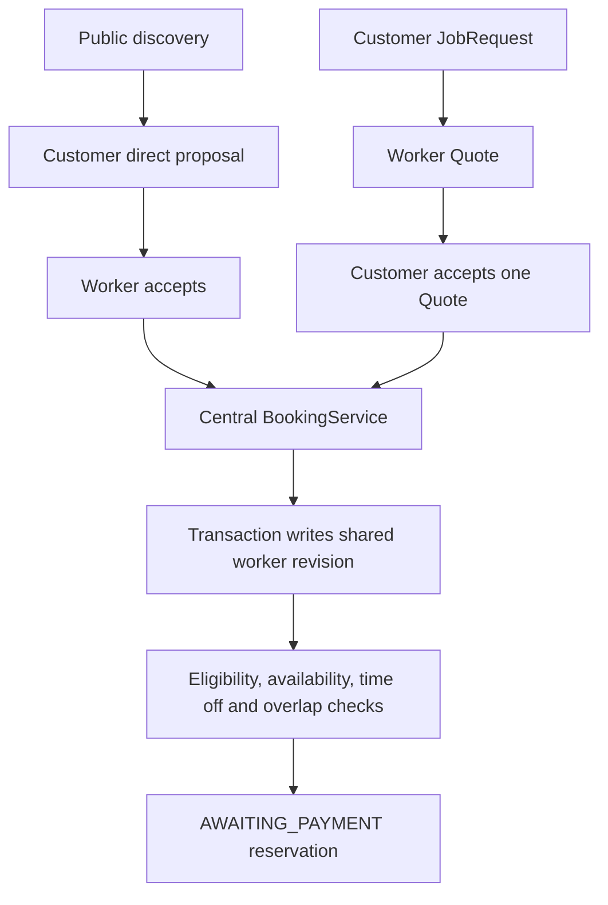
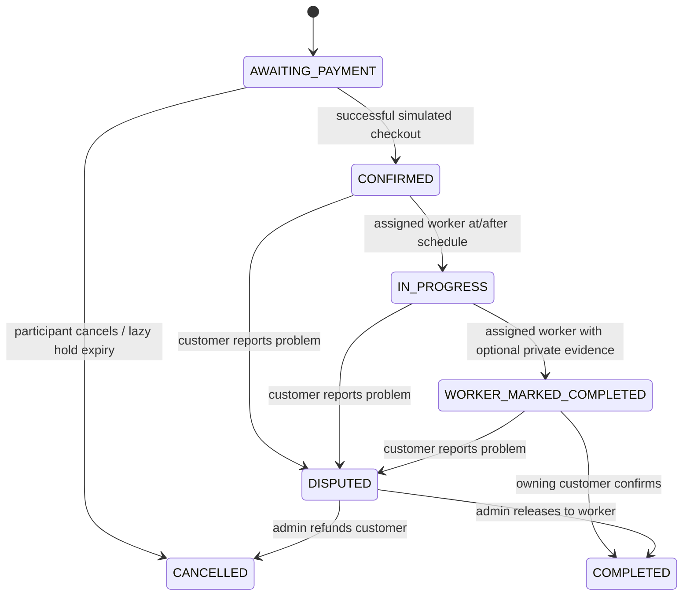
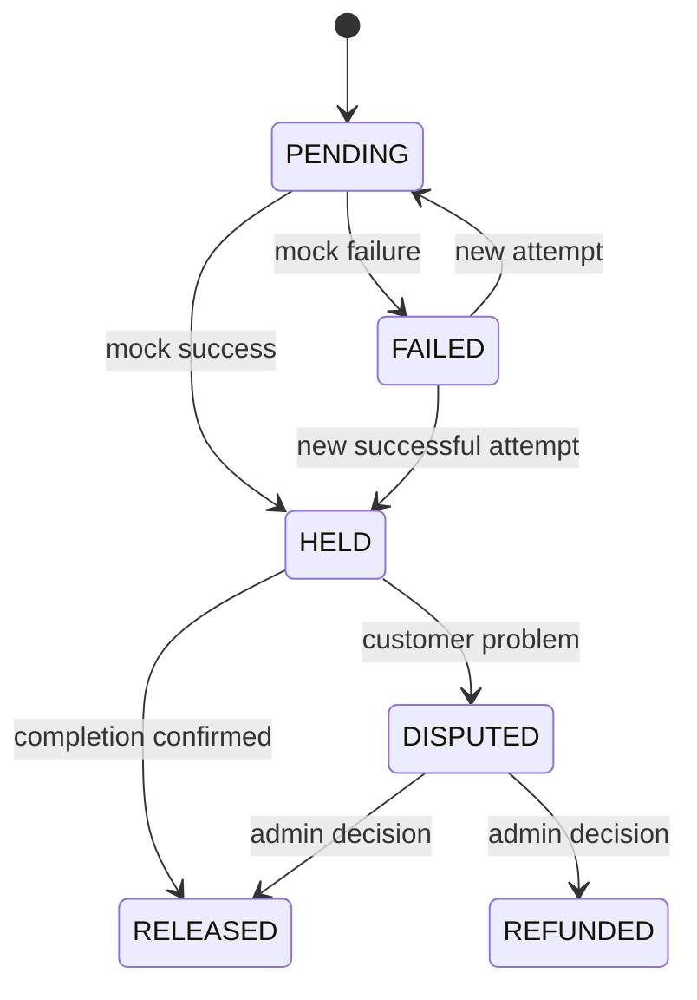
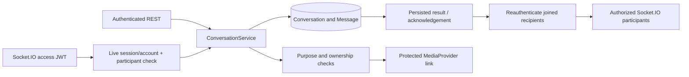

# Approved architecture and phase boundaries

Phase 1 implements User and Session. Phase 2 adds WorkerProfile, Category, Service, MediaAsset, Verification and AuditEvent. Phase 3 adds Discovery/Matching services, JobRequest and Quote. Phases 4–9 add availability, direct proposals, unified bookings, private messaging, mock payments/ledger, completion/disputes/reviews, notifications and admin operations. Authentication/session behavior is preserved.

V1 adds Availability, WorkerScheduleLock, DirectProposal, Booking, Conversation, Message, Payment, PaymentAttempt, FinancialLedgerEntry, Dispute, Review and Notification. No deferred real-payment, frontend, GPS or AI models are implemented.

Preserved decisions:
- Modular monolithic REST API with routes → controllers → services → models.
- Direct search uses a pending worker-accepted booking proposal; JobRequest hiring uses accepted Quotes. Both converge on the same Booking service.
- Availability uses Africa/Banjul for local recurring hours and UTC booking timestamps.
- Booking overlap uses newStart < existingEnd && newEnd > existingStart; adjacent slots do not overlap.
- Future booking reservation uses a replica-set transaction with a shared worker availability revision write before conflict checks. All availability/occupancy changes use the same rule. Pending payment holds expire.
- Verification identity documents require protected delivery; private completion evidence is separate from public portfolios.
- PaymentService uses a replaceable PaymentProvider contract; V1 uses only MockPaymentProvider. No real payments or regulated escrow claim.
- Money uses integer bututs, configurable basis-point commission, idempotent payment operations and unique ledger event keys.
- FinancialLedgerEntry records simulated worker credits/platform revenue; AuditEvent records sensitive administrator decisions.
- Reviews require completed Bookings and are unique per Booking.
- Phase 2: profiles/catalog/media/verification. Phase 3: discovery/jobs/quotes. Phase 4: availability/bookings. Phase 5: messaging. Phase 6: mock payments/ledger. Phase 7: completion/disputes/reviews. Phase 8: notifications/admin. Phase 9: integrated testing/security/documentation.
- Tests accompany every phase. Phases 2 and 3 were explicitly approved. The subsequent implementation request explicitly authorized Phases 4–9 sequentially; this document now records the complete V1 boundary.

Refresh rotation uses an atomic conditional update; see the [Mongoose documentation](https://mongoosejs.com/docs/tutorials/findoneandupdate) for its atomic-update behavior. Application code handles reuse by revoking the session.

## Phase 2 implemented design

### Relationships and sources of truth

User (WORKER) → one WorkerProfile via a unique user index. Registration still creates only User; explicit onboarding creates the profile. Services belong to Categories; profiles reference Services. Skills are embedded strings. Named GM service areas, a private optional GeoJSON Point ([longitude,latitude]), and serviceRadiusKm establish Phase 3-compatible metadata without implementing discovery. A 2dsphere index covers primaryLocation.

Profile pricing is embedded per Service, using integer safe bututs and GMD. QUOTE_REQUIRED has no amount; the other types require one. Portfolio embeds bounded metadata and references immutable owned MediaAssets. PROFILE_IMAGE and PORTFOLIO purposes are distinct from IDENTITY_DOCUMENT, SKILL_CERTIFICATE and WORK_EVIDENCE. No private verification evidence is automatically published. WorkerProfile has optimistic concurrency enabled for save-based professional/portfolio updates.

Verification stores one document per attempt. NOT_SUBMITTED is absence, not an empty collection record. A unique partial index on worker for PENDING/APPROVED prevents parallel active applications. Rejected documents remain historical. Only PENDING is reviewable; rejected workers can create another attempt. The latest authoritative Verification drives public badges and own status. No separate persisted verification cache can disagree with it.

Identity Verified means APPROVED identity evidence. Work Evidence Reviewed also requires nonempty work evidence and an explicit administrator review flag. Verified Worker requires both. Certificates never imply a formal license/certification badge. Completion is calculated from eight meaningful profile/submission components. Rating/review/job counters are protected foundations only.

### Transaction and audit boundaries

Catalog mutations and review decisions each commit their AuditEvent atomically. Submission also uses a transaction plus the partial unique index, preserving state invariants under concurrent requests. These Phase 2 operations require a replica set. Existing standalone Phase 1 operations remain supported; deployment documentation now explains the additional Phase 2 requirement. Catalog references are preserved through deactivation; inactive services/categories are not publicly advertised or newly selected.

AuditEvent stores actor, action, resourceType, resource ID, changed field names and createdAt. No contents, signed URLs, administrator-note text or reference contacts are copied into audit events. There is no public audit mutation API.

### Access boundaries

Routes reuse existing authentication and role middleware. Controllers delegate to services; validators allowlist bodies and validate IDs/pagination. Profile writes use only req.auth.user, never a client-supplied owner. Public serializers select names and professional information explicitly. They omit contact information, security fields, exact coordinates, references, identity files, notes and rejection reasons. Live account status and PUBLIC visibility gate reads. Missing professional fields, inactive services/categories, DRAFT or inactive accounts fail closed.

MediaService controls ownership, purpose, payload validation and metadata. CloudinaryMediaProvider owns provider-specific methods and credentials. All stored files use authenticated delivery; public images are shared only through temporary links minted after profile eligibility checks. Document links require authenticated owner/ADMIN authorization. No raw Cloudinary upload response or permanent document URL reaches serializers.

[Cloudinary's documented authenticated delivery and private_download_url](https://cloudinary.com/documentation/control_access_to_media) protect originals/derivatives and support time-limited API delivery without relying on premium CDN authentication tokens. Link recipients can share links during their short lifetime; URL minting is authorized, and already minted links cannot be individually revoked through this V1 API. Images are re-encoded without metadata; PDFs have basic format checks and attachment delivery, with malware scanning deferred.

### Scope and remaining operational work

Public profile eligibility is not a verified-worker requirement: unverified workers can have complete public profiles with accurate empty badges. This separates professional presentation from reviewed trust status. Phase 3 can later filter/search by verification. availableNow is declarative, not an availability calendar.

Live Cloudinary integration requires credentials and account settings; automated tests use a fake external provider plus SDK contract tests. The profile/verification authorization, 2dsphere index structure, transaction rollback and concurrent-submission invariants are exercised against real temporary MongoDB. Storage retention, orphan cleanup, antivirus scanning, verification expiration/revocation, production rate-limit infrastructure and future account administration are not implemented. No Phase 3+ business functionality was added during Phase 2.

## Phase 3 implemented design

### Two marketplace entry paths

Discovery produces safe worker cards using the same worker User ID as the existing public profile endpoint. Public browsing does not require identity approval unless filtered; quote submission/opportunity access does. This leaves the approved direct-hire proposal → worker acceptance → centralized BookingService path intact for Phase 4, without implementing it. JobRequest hiring now reaches one accepted Quote and commercial agreement only.

### Shared eligibility and deterministic matching

Discovery/Matching reuse an aggregation eligibility pipeline: PUBLIC and professionally complete profile, active WORKER User, all referenced Services and Categories active, latest authoritative Verification. User lookups project names only; sensitive fields are never required. Worker cards explicitly serialize professional data and coarse distance. No raw Mongoose/aggregation documents are returned.

An APPROVED identity verification is the minimum quote/opportunity trust state. Work Evidence Reviewed/Verified Worker remain stronger existing badges; no license is inferred. Matching requires requested Service, normalized area/country, compatible optional region, and (when both points exist) distance within the worker radius capped by server configuration. Without one of the optional points, declared area matching is used. Active customer checks keep inactive-account jobs out of opportunities and mutation paths.

Discovery uses $geoNear first with the 2dsphere index and early visibility/service filters; opportunities use $geoWithin on JobRequest.location when the worker has a point. Input order is [longitude,latitude], radius inputs are integer kilometres, MongoDB distance is metres. Only rounded-up five-kilometre bands are exposed. No customer exact location/address is returned to workers, even after Phase 3 quote acceptance. This does not provide a formal anonymity guarantee against repeated geographic boundary probing.

### Job and quote invariants

JobRequest belongs to one CUSTOMER and active Service. It embeds private location/address, shared named area, budget, bounded owned image references, schedule preferences, lifetime quoteCount, expiry, mutation revision and optional accepted agreement. Statuses: OPEN, QUOTE_ACCEPTED, CANCELLED, effective EXPIRED. The complete brief becomes immutable after the first submitted quote, even if withdrawn; cancellation + a new brief is the explicit alternative.

Quote belongs to one job/worker/customer, with validated safe integer bututs, bounded message, optional duration/date proposal, expiry and PENDING/ACCEPTED/REJECTED/WITHDRAWN/EXPIRED state. A unique (jobRequest,worker) index means one quote total, with pending edits and no revision collection. Normal activities do not create administrative audit events.

The accepted agreement snapshot preserves customer/worker/service/job/quote IDs, amount, currency, duration, proposal date/note/message, agreed brief, named area and acceptance time. It is an API-immutable commercial handoff, not a time reservation or Booking. Precise fulfillment data remains private on the immutable accepted JobRequest.

### Shared job write and transaction boundaries

Every pending quote mutation, new quote, job update/cancellation and acceptance first conditionally increments the same OPEN/unexpired JobRequest.revision within a transaction. This creates an actual database write conflict; merely reading OPEN in separate transactions would not suffice. MongoDB retries conflicting transactions against fresh state. Acceptance updates the selected quote, closes pending competitors (EXPIRED if already expired, otherwise REJECTED), changes the job and saves the agreement in the same transaction. A unique partial jobRequest index for ACCEPTED Quotes is an additional invariant. All Phase 3 multi-document lifecycle actions require a replica set; no process-local lock is used.

Tests cover duplicate submissions, simultaneous acceptance, acceptance versus quote edits/late submissions and rollback on snapshot persistence failure. See [MongoDB atomicity guidance](https://www.mongodb.com/docs/manual/core/write-operations-atomicity/) and [transaction stale-read guidance](https://www.mongodb.com/docs/v8.0/core/transactions-production-consideration/).

### Expiry and retention

Reads derive EXPIRED for OPEN jobs/PENDING quotes past expiresAt; pending quotes also expire if their still-OPEN job expires. Writes filter server-time expiry and reject expired states, so no scheduler is needed for correctness. Stored status can remain OPEN/PENDING after expiry. Accepted agreements retain their terminal status after original offer deadlines. No business-history TTL deletion is used. Cancellation is allowed only for OPEN/unexpired jobs and atomically closes pending quotes; accepted cancellation belongs to Phase 4 policy.

### Media and privacy boundaries

JOB_ATTACHMENT extends existing authenticated media storage, image size/decoding/metadata controls and ownership checks. Only CUSTOMER may upload that purpose; only WORKER may upload the original worker purposes. Generic customer media access is restricted to their own job images, preserving customer denial for worker verification media. PublicImage's purpose allowlist still excludes JOB_ATTACHMENT. Matching workers can obtain short-lived links only through a job-scoped authorization check while the job is OPEN/relevant.

Free text and visible photo contents are not automatically redacted; contact filtering, OCR/AI and voice notes remain out of scope. Exact coordinates/private addresses, account contacts, verification documents and admin notes are omitted from opportunity/card/quote serializers. Existing temporary-link sharing/expiry limitations remain.

### Index purposes and future handoff

WorkerProfile visibility/services narrows public candidates; existing primaryLocation 2dsphere drives nearby searches. JobRequest customer/createdAt/ID supports private lists; status/service/areaKey/expiresAt and status/expiresAt support open-opportunity filters; location 2dsphere supports radius constraints. Quote worker/createdAt/ID supports own lists; jobRequest/status/expiresAt supports comparison and closing competitors; pair uniqueness prevents duplicates; accepted-only uniqueness prevents multiple accepted quotes.

Phase 4 must consume acceptedQuote + JobRequest.agreement with an idempotent unique acceptedQuote-to-Booking link, confirm actual scheduling inputs, and perform the previously approved centralized availability/conflict checks. Both quoted hiring and direct proposals must converge on BookingService. Availability, bookings/proposals, reservations, chat, payments, reviews, notifications, analytics and AI remain unimplemented.

## V1 integration: Phases 4–9

The complete backend keeps the original modular monolith. Existing authentication/session services, verification decisions, public DTOs and Phase 3 acceptance transaction are preserved. New feature services own their state transitions. Routes validate input, enforce authentication/RBAC and delegate to service methods through thin handlers. Storage-specific behavior stays inside providers.

### Sources of truth and models

| Model | Source of truth |
| --- | --- |
| User / Session | Identity, live role/account status, token version and rotating refresh sessions |
| WorkerProfile | Professional/public eligibility, services, areas, GeoJSON, pricing and derived reputation |
| Category / Service | Database-managed active catalog |
| MediaAsset | Owner, purpose and authenticated provider reference; no raw provider locator in normal DTOs |
| Verification / AuditEvent | Evidence-backed review state and sensitive administrator action history |
| JobRequest / Quote | Customer brief, accepted commercial agreement and one offer per worker/job |
| Availability | Africa/Banjul recurring intervals, blocked dates and UTC time off |
| WorkerScheduleLock | Shared per-worker transaction contention revision; no business-facing endpoint |
| DirectProposal | Customer-proposed terms requiring worker acceptance |
| Booking | Single hiring/scheduling/execution source, regardless of commercial route |
| Conversation / Message | Explicit participant context and persisted text/image/voice/read state |
| Payment / PaymentAttempt | Simulated held/released/refunded money state and idempotent checkout outcomes |
| FinancialLedgerEntry | Unique auditable simulated financial events |
| Dispute | One customer problem report per booking and audited administrative settlement |
| Review | One customer rating per completed booking, with separate moderation visibility |
| Notification | Recipient-scoped fixed-content event notification with deduplication |

### Hiring and scheduling

The worker lock row is created outside a transaction with an idempotent unique `_id` upsert, then written inside every scheduling transaction before occupancy checks. Quote-to-booking and proposal-to-booking share this exact engine. Unique acceptedQuote/directProposal indexes prevent duplicate source conversion. Published weekly availability authorizes accepted-quote scheduling within those intervals; a direct proposal requires worker consent to its exact interval.

All scheduling writes use the same worker lock, including availability replacement, payment confirmation and settlement. Optimistic transactional writes force concurrent operations to retry on a fresh snapshot. Availability cannot be edited to exclude a reserved/active booking. The standard overlap predicate is strict on both bounds, so touching endpoints are allowed.

Africa/Banjul recurring schedules use explicit Intl civil-time formatting; current Banjul time is UTC+00 with no seasonal offset. Actual booking/time-off timestamps are UTC. V1 supports same-day, minute-aligned intervals and validates future horizon, ordering and maximum duration. Blocked dates use validated ISO dates. Overnight recurring work must be split into separate days; a single booking spanning midnight is outside V1 availability rules.

### Booking and payment lifecycles

AWAITING_PAYMENT holds default to 15 minutes, capped by scheduled start. Expired holds no longer block and cannot be paid. Reads expose effective cancellation without requiring a scheduler. Accepted source conversion remains idempotent after cancellation/expiry and does not create a replacement booking silently.

A mock result can initially be FAILED or HELD; SUCCESSFUL is a transient conceptual result rather than a stored state. Business services depend on the provider interface, not MockPaymentProvider. No external money moves, and retrying a mock call inside a database transaction has no external financial side effects. A future real provider would require verified callbacks and an outbox/idempotent external-call design before adoption.

Booking+Payment+PaymentAttempt+initial ledger writes commit together. Completion, refund and dispute resolution also commit their booking/payment/ledger/reputation/audit changes together. Customer idempotency keys are bound to booking and outcome. Provider names/status/reference outputs are bounded and validated. Commission is calculated using BigInt intermediate arithmetic and floor division; all persisted event amounts are safe integer bututs.

The ledger is event-based, not a bank balance or regulated escrow. Collection, provisional commission and pending worker earning are separate event types; release/refund close the hold. Unique payment/type keys prevent repeated events. Recognized commission derives from released payment state; full refunds do not count as revenue. Aggregate summaries use Decimal128 aggregation and decimal strings to preserve precision.

### Messaging architecture

Conversations reference a Quote, DirectProposal or Booking and explicitly store participants; a Quote provides the JobRequest relationship. No arbitrary user-to-user messaging endpoint exists. The service supplies REST history and read state independently of Socket.IO. SYSTEM is model-supported but not client-selectable. Sender/conversation/clientMessageId uniqueness makes resends idempotent. Duplicate ID with changed contents is rejected.

Socket authentication reuses the original AuthService and validates active sessions, token versions, account status, audience/issuer/algorithm/expiry. Every action reauthenticates. Room joins enforce ownership and every recipient is revalidated before delivery, so an old room membership cannot preserve revoked access. Payloads are 16 KiB maximum with per-connection action limits. Cross-origin handshakes use only the configured frontend origin. Reconnect clients use REST history; delivery may repeat an idempotent message event.

Contact detection centralizes Unicode normalization, obvious Gambian phone formats, emails and known contact/social links. It runs on TEXT messages until the related booking is payment-confirmed. Labelled money/measurements reduce false positives. It cannot reliably detect obfuscation, visual/audio contacts or deliberate mislabelling; no AI or speech analysis is claimed.

### Media authorization matrix

| Purpose | Upload role | Other authorized access |
| --- | --- | --- |
| PROFILE_IMAGE / PORTFOLIO | WORKER | Eligible public DTOs issue bounded links |
| IDENTITY_DOCUMENT / SKILL_CERTIFICATE / WORK_EVIDENCE | WORKER | Authorized verification ADMIN; owning worker |
| JOB_ATTACHMENT | CUSTOMER | Currently matching worker through OPEN job attachment endpoint |
| CHAT_IMAGE / VOICE_NOTE | CUSTOMER / WORKER | Conversation participants through message relationship |
| COMPLETION_EVIDENCE | WORKER | Booking participants / ADMIN through booking evidence relationship |
| DISPUTE_EVIDENCE | CUSTOMER / WORKER | Booking participants / ADMIN once linked as dispute evidence |

All storage uses authenticated delivery. Ordinary response serializers contain media IDs rather than sensitive provider keys or permanent URLs. Images are decoded/re-encoded to remove metadata. Voice uses bounded PCM WAV / Opus Ogg/WebM validation and Cloudinary's authenticated audio-capable resource type through the provider adapter. The client records/plays audio; backend transcription is absent. Uploaded evidence never automatically joins a public portfolio.

The owner access endpoint remains restricted by purpose for CUSTOMER. Other users need a persisted authorized marketplace relationship. Signed links can be shared until expiry; provider-side retention, malware scanning and recording-content moderation are future operational controls.

### Reviews, disputes and counters

One dispute and one review per booking have database unique indexes. Only the booking's CUSTOMER can open a dispute on a paid active booking or review a COMPLETED booking. Only the assigned WORKER starts/marks completion. Only ADMIN resolves disputes or moderates reviews. State checks occur server-side in a transaction, never from an arbitrary status body.

Completion/dispute/settlement/review/moderation use the worker contention row. Reputation is recalculated from visible genuine reviews and completed bookings inside the transaction, rather than trusting concurrent increments. Moderation stores its reason/reviewer/time without changing the original rating. Sensitive admin decisions create AuditEvent, and audit failures roll back settlement/moderation/account status. Admin suspension revokes sessions and token versions; reactivation requires fresh credentials.

### Notifications and operational metrics

Write services are decorated with post-commit notification effects. Fixed safe messages contain resource references, not private work text, identity evidence, addresses or contact data. Recipient/event keys deduplicate retries. Optional email providers are injectable, disabled by default and isolated from marketplace success. This V1 design is best effort; there is no durable outbox or scheduled reminder worker. A process crash after commit may omit a notification, and supplemental emails can repeat on retries. These limits do not alter booking/payment correctness.

Admin metrics use actual counts and aggregation. Simulated gross collected volume includes held/released/refunded paid attempts; refunds are reported separately; revenue includes only released platform fees. Expired unpaid reservations are treated as cancelled. No fabricated ratings, recommendations, revenue or admin balance mutation is provided.

### Important new indexes

- Availability.worker and WorkerScheduleLock._id: unique per worker configuration/contention.
- Booking.worker/status/scheduledStart/scheduledEnd: conflict candidate lookup; customer/worker creation indexes: management history.
- Booking.acceptedQuote and directProposal: partial unique ObjectId indexes, enforcing one conversion per source.
- DirectProposal.worker/status/expiresAt and customer history: recipient queue and customer management.
- Conversation.contextType/contextId unique, participants/creation: context deduplication and participant history.
- Message.conversation/createdAt/_id: bounded history; conversation/sender/clientMessageId unique: resend deduplication.
- Payment.booking unique, worker/status and status/creation: source consistency, balances and admin operations.
- PaymentAttempt.customer/key unique: request idempotency.
- FinancialLedgerEntry.payment/type unique, worker/type/creation: auditable movements and worker history.
- Dispute.booking unique, status/creation and participant history: one case and admin queue.
- Review.booking unique and worker/moderationStatus/creation: genuine reviews and public listing.
- Notification.recipient/eventKey unique and recipient/readAt/creation: safe deduplication, unread count/history.

No TTL index deletes booking, payment, dispute, ledger or accepted commercial records. Expiration remains a business state check. Index creation is part of startup; historical duplicates must be repaired through an explicit migration before deployment. Collections are initialized by index creation, and no destructive syncIndexes migration is run automatically.

### Deployment boundary

The server supports HTTP + Socket.IO on one process, exact CORS origin, environment validation, a bounded trusted-proxy hop count, liveness/readiness and graceful shutdown. Cloudinary is remote; no runtime upload filesystem is required. JWTs, private URLs, credentials and document payloads are not logged. Errors remain the existing safe response shape. Production must supply TLS, proper secrets, replica-set connectivity, backups, protected admin provisioning and storage credentials.

Single-process in-memory rate limits and realtime delivery are the V1 deployment target. Horizontal scaling needs a shared rate limiter, shared Socket.IO adapter and appropriate transport/session affinity. Database transactions and worker locks continue to coordinate booking/money correctness across processes. This is deployment preparation, not an actual deployment or a claim of production certification.

Official realtime reference: [Socket.IO server API](https://socket.io/docs/v4/server-api/) and [authentication middleware](https://socket.io/docs/v4/middlewares/).
# Private direct-hire quote extension

DirectProposal also supports REQUEST_QUOTE without an agreed amount, optional budget range, protected JOB_ATTACHMENT photos and versioned professional offers. The customer accepts the exact current valid revision, atomically creating the booking through the existing factory/worker lock. LISTED_PRICE snapshots and validates a current FIXED listing; legacy customer-priced proposals keep worker acceptance. Public JobRequest/Quote records retain their original semantics. See [flexible pricing implementation](../../frontend/docs/flexible-pricing.md) and the updated OpenAPI document for current contracts.

